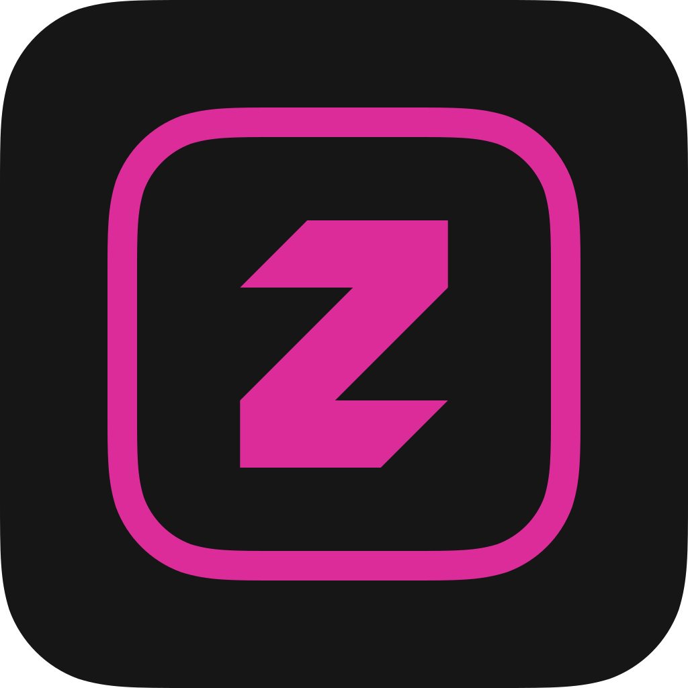

<div align="center">
  
  <h1><b>zContainer</b></h1>
  <p><i>Runs iOS apps inside one app, without installing them.</i></p>
</div>

zContainer is a modified version of [LiveContainer](https://github.com/LiveContainer/LiveContainer) 3.8.11 (commit 9108ae6), changed for [Zeus](https://getzeus.app) since October 18, 2026. It runs apps inside itself, so they all share its one App ID: with a free developer account, you can use more apps than the 3 app limit allows. LiveContainer does the actual work, and all credit for it goes to its authors (see [Credits](#credits)).

> [!NOTE]
> zContainer is not made or supported by the LiveContainer project. Please report problems with zContainer to [zContainer's issues](https://github.com/getzeusapp/LiveContainer/issues), not to LiveContainer.

## Installing

zContainer is installed with [Zeus](https://getzeus.app). When you allow it, Zeus puts the certificate it signs zContainer with inside the app, and zContainer takes it in on launch, so apps run JIT-less without any setup. Installed another way, import the certificate that signed it in Settings.

Requirements: iOS or iPadOS 17 or later. Multitasking needs the app extensions.

For how to use it (installing apps, Home Screen shortcuts, multitasking, JIT, tweaks, containers, hiding apps), LiveContainer's [documentation](https://livecontainer.github.io/docs/intro) and [FAQ](https://livecontainer.github.io/docs/faq) apply to zContainer too.

## What changed from LiveContainer

- zContainer has its own name, icon, bundle ID (`app.reiko.zcontainer`), URL scheme (`zcontainer`) and keychain groups (`app.reiko.zcontainer.shared` and `.1` to `.127`), so it can be installed next to LiveContainer. Its app group is named after its bundle ID.
- It takes in the certificate Zeus includes when signing it (`LiveContainer/LCZeusCertificate.m`).
- SideStore and AltStore support, the built-in SideStore and the installer for more LiveContainers are removed.
- It builds on Linux (see [Building](#building)).
- Settings > About zContainer credits LiveContainer and its authors, links to this source code and shows the license notices.

Internal names (the `LiveContainerShared` and `LiveContainerSwiftUI` modules, the `LC` classes and the `lc.` string keys) stay as they are, so changes from LiveContainer keep merging cleanly.

## Building

On Linux, without Xcode:

```sh
git submodule update --init --recursive
Scripts/zc/build.sh
```

This builds `build/zc/zContainer.ipa`. [Scripts/zc/README.md](Scripts/zc/README.md) lists what the build needs and its settings. The Xcode project builds too: set `DEVELOPMENT_TEAM` in `xcconfigs/Global.xcconfig` to your team ID.

The icon is drawn in `Scripts/zc/art/AppIcon.svg`. `Scripts/zc/art/render-icon.sh` renders it into the asset catalog.

## Source code and license

zContainer is licensed under the [GNU Affero General Public License v3.0](LICENSE), like LiveContainer. Its complete source code, build scripts included, is at <https://github.com/getzeusapp/LiveContainer>. <!-- A placeholder until the public repository is set up; Settings > About links to it too (LCAboutLinks.swift). --> It comes with no warranty.

## How it works

zContainer runs LiveContainer's runtime as it is. The rest of this section is from LiveContainer's README.

### Project structure
#### Main executable
- Core of LiveContainer
- Contains the logic of setting up guest environment and loading guest app.
- If no app is selected, it loads LiveContainerSwiftUI.

#### LiveContainerSwiftUI
- SwiftUI rewrite of LiveContainerUI (by @hugeBlack)
- Language file `Localizable.xcstrings` is in here for multilingual support. To help us translate LiveContainer, please visit [our crowdin project](https://crowdin.com/project/livecontainer)

#### MultitaskSupport
- Contains the implementation of multitasking feature.
- Based on [FrontBoardAppLauncher](https://github.com/khanhduytran0/FrontBoardAppLauncher)

#### TweakLoader
- A simple tweak injector, which loads CydiaSubstrate and loads tweaks.
- Injected to every app you install in LiveContainer.

#### ZSign
- The app signer shipped with LiveContainer.
- Originally made by [zhlynn](https://github.com/zhlynn/zsign).
- LiveContainer uses [Feather's](https://github.com/khcrysalis/Feather) version of ZSign modified by khcrysalis.
- Changes are made to meet LiveContainer's needs.

### How guest apps run

#### Patching guest executable
- Patch `__PAGEZERO` segment:
  + Change `vmaddr` to `0xFFFFC000` (`0x100000000 - 0x4000`)
  + Change `vmsize` to `0x4000`
- Change `MH_EXECUTE` to `MH_DYLIB`.
- Inject a load command to load `TweakLoader.dylib`

#### Patching `@executable_path`
- Hook `dyld4::APIs::_NSGetExecutablePath`
- Call `_NSGetExecutablePath`
- Replace `config.process.mainExecutablePath`
  - Calculate address of `config.process.mainExecutablePath` using `dyld4::APIs` instance (passed as first parameter)
  - Use `builtin_vm_protect` or TPRO unlock to make it writable
  - Replace the address with one we have control of
- Put the original `dyld4::APIs::_NSGetExecutablePath` back

> Old Method
>- Call `_NSGetExecutablePath` with an invalid buffer pointer input -> SIGSEGV
>- Do some [magic stuff](https://github.com/khanhduytran0/LiveContainer/blob/5ef1e6a/main.m#L74-L115) to overwrite the contents of executable_path.

#### Patching `NSBundle.mainBundle`
- This property is overwritten with the guest app's bundle.

#### Bypassing Library Validation
- JIT is optional to bypass codesigning. In JIT-less mode, all executables are signed so this does not apply.
- Derived from [Restoring Dyld Memory Loading](https://blog.xpnsec.com/restoring-dyld-memory-loading)

#### dlopening the executable
- Call `dlopen` with the guest app's executable
- TweakLoader loads all tweaks in the selected folder
- Find the entry point
- Jump to the entry point
- The guest app's entry point calls `UIApplicationMain` and start up like any other iOS apps.

#### Multi-Account support & Keychain Semi-Separation
[128 keychain access groups](./entitlements.xml) are created and LiveContainer allocates them randomly to each container of the same app. So you can create 128 container with different keychain access groups.

### Limitations
- Entitlements from the guest app are not applied to the host app. This isn't a big deal since sideloaded apps requires only basic entitlements.
- App Permissions are globally applied.
- Guest app containers are not sandboxed. This means one guest app can access other guest apps' data.
- App extensions aren't supported. they cannot be registered because: LiveContainer is sandboxed, SpringBoard doesn't know what apps are installed in LiveContainer, and they take up App ID.
- Multitasking can be achieved by using multiple LiveContainer and the multitasking feature. However, while we were able to fix physical keyboard input issue on iPadOS (https://github.com/LiveContainer/LiveContainer/issues/524), iPhone Mirroring uses different checks which still broke it (https://github.com/LiveContainer/LiveContainer/issues/793).
- Remote push notification will not work
- Querying custom URL schemes might not work(?)

## Credits

zContainer exists because of LiveContainer, made by [Duy Tran (khanhduytran0)](https://github.com/khanhduytran0), [Huge_Black (hugeBlack)](https://github.com/hugeBlack) and [its contributors](https://github.com/LiveContainer/LiveContainer/graphs/contributors).

LiveContainer's credits:
- [xpn's blogpost: Restoring Dyld Memory Loading](https://blog.xpnsec.com/restoring-dyld-memory-loading)
- [LinusHenze's CFastFind](https://github.com/pinauten/PatchfinderUtils/blob/master/Sources/CFastFind/CFastFind.c): [MIT license](https://github.com/pinauten/PatchfinderUtils/blob/master/LICENSE)
- [litehook](https://github.com/opa334/litehook): [MIT license](https://github.com/opa334/litehook/blob/main/LICENSE)
- @haxi0 & @m1337v for LiveContainer's icon
- @Vishram1123 for the initial shortcut implementation.
- @hugeBlack for SwiftUI contribution
- @Staubgeborener for automatic AltStore/SideStore source updater
- @fkunn1326 for improved app hiding
- @slds1 for dynamic color feature
- @Vishram1123 for iOS 26+ JIT Script Support
- @StephenDev0 for AltStore source support

zContainer also ships:
- [OpenSSL](https://www.openssl.org): [Apache License 2.0](https://www.openssl.org/source/license.html)
- [ElleKit](https://github.com/evelyneee/ellekit)'s CydiaSubstrate, by Évelyne Bélanger: BSD license (its `LICENSE` is in `Resources/Frameworks/CydiaSubstrate.framework`)
- [zsign](https://github.com/zhlynn/zsign) by zhlynn, in [Feather](https://github.com/khcrysalis/Feather)'s version by khcrysalis
